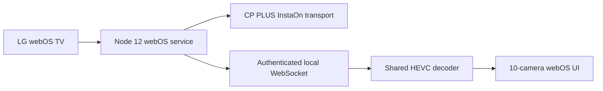

# webOS InstaOn Viewer

<p align="center">
  
</p>

<p align="center">
  Direct CP PLUS InstaOn live-view foundation for LG webOS TV — designed for a ten-channel default wall, single-camera enlargement, and remote-friendly navigation.
</p>

<p align="center">
  
  <a href="releases/tag/v0.4.2"></a>
  <a href="https://webostv.developer.lge.com/develop/tools/simulator-installation"></a>
</p>

> **Status:** v0.4.2 is the stable personal-use feature baseline. This is an independent project and is not affiliated with CP PLUS, Dahua, InstaOn, or LG.

## What it does

- Starts with a 10-camera SD layout and supports 4, 8, 10, and 16 tiles.
- Enlarges one focused camera for HD viewing and returns to the multi-camera wall with Back.
- Supports arrow navigation, Enter/OK activation, Back key code 461, pause/resume, Fit/Fill, and aspect-ratio overrides.
- Runs transport and decoding on the TV package; a laptop is used for development and simulator work, not as a playback gateway.
- Keeps private recorder details in one ignored `config.local.json`; no credentials are stored in the public repository.

## Architecture



The public repository contains source, tests, configuration examples, and documentation. Vendor decoder assets, simulator installers, private packages, camera footage, and credentials are intentionally excluded.

## Official software and setup resources

These links are provided for setup and compatibility research; download only software appropriate for the recorder model and use authorized accounts/assets.

| Resource | Link |
| --- | --- |
| CP PLUS Windows software — KVMS Pro Lite, IP Finder, SmartPlayer, web plugins | [CP PLUS Software](https://cpplusworld.com/software) |
| CP PLUS FAQs, including cloud/InstaOn and client-software guidance | [CP PLUS FAQ](https://cpplusworld.com/faq) |
| CP PLUS troubleshooting knowledge base | [CP PLUS Troubleshooting](https://cpplusworld.com/Troubleshooting/1) |
| CP PLUS manuals for DVR, NVR, and cameras | [CP PLUS User Manuals](https://cpplusworld.com/user-manual) |
| LG webOS TV Simulator for Windows and other supported platforms | [LG Simulator Installation](https://webostv.developer.lge.com/develop/tools/simulator-installation) |
| LG simulator development and debugging guide | [LG Simulator Development Guide](https://webostv.developer.lge.com/develop/tools/simulator-dev-guide) |

## Offline-first quick start

Use a host Node/npm version supported by the build tooling. Node 12 compatibility is required by the deployed service, not necessarily by every host tool.

```sh
npm ci
npm test
npm run configure
```

`npm run configure` creates an untracked `config.local.json` from `config.example.json` and refuses to overwrite an existing local file. Edit only that local file for your environment:

```json
{
  "recorder": {
    "instaOnId": "YOUR_PRIVATE_INSTAON_ID",
    "username": "YOUR_PRIVATE_USERNAME",
    "password": "YOUR_PRIVATE_PASSWORD"
  },
  "cloud": { "host": "instaonserver.com", "port": 8800 },
  "viewer": { "cameraCount": 10, "defaultView": 10 }
}
```

Never put real values in `config.example.json`, README files, issue reports, screenshots, logs, or release assets.

## Simulator workflow

1. Install the official LG webOS TV Simulator and webOS CLI/SDK tools.
2. Configure local simulator, CLI, authorized decoder-asset, and SDK paths in `config.local.json`.
3. Build and run the simulator checks:

   ```sh
   npm run build
   npm run simulator -- --debug
   npm run qa:simulator
   ```

4. Validate focus, Enter/OK, Back, 4/8/10/16 layouts, enlargement, Fit/Fill, pause/resume, and overflow. Keep `television.enabled: false` during simulator-only work.

The simulator is not a physical-TV performance benchmark. A live simulator session can still contact the recorder, so use offline checks by default and authorize a media session explicitly when needed.

## Build, package, and privacy checks

```sh
npm test
npm run build
npm run package
npm run privacy
```

Packages can contain private configuration and must not be uploaded automatically. The privacy scan is a guardrail, not a substitute for reviewing tracked files, Git history, and release attachments.

## Documentation and handoff

- [Stable v0.4.2 baseline and limitations](docs/STABLE_BASELINE.md)
- [Current LLM handoff v2 — pending tasks](docs/LLM_HANDOFF_V2.md)
- [Original handoff and preserved baseline](docs/LLM_HANDOFF.md)
- [Architecture and component ownership](docs/ARCHITECTURE.md)
- [Feature and activity roadmap](docs/ROADMAP.md)
- [Fresh source/export validation](docs/VALIDATION.md)
- [Skills and upstream links](docs/SKILLS.md)
- [Local config and private build setup](docs/SETUP.md)
- [Local display profiles](docs/PROFILES.md)
- [Publication, privacy, and licensing boundaries](docs/PRIVACY.md) · [LICENSING.md](docs/LICENSING.md)
- [Agent working rules](AGENTS.md)

## Search keywords

`CP PLUS` · `CPPLUS` · `CP Plus DVR` · `CP Plus NVR` · `XVR` · `CCTV` · `IP camera` · `InstaOn` · `GCMOB` · `iCMOB` · `KVMS Pro Lite` · `Dahua` · `Dahau` (common misspelling) · `Dahua-compatible transport` · `LG webOS` · `webOS TV 23 Simulator` · `webOS DVR viewer` · `webOS NVR viewer` · `live camera wall` · `HEVC` · `RTSP` · `PTCP` · `Node.js webOS service`

## License and provenance

The license decision for project-owned code is pending. Do not infer a project-wide MIT license from dependency metadata. The pinned `dahua-p2p@1.0.0` dependency has conflicting provenance signals documented in [LICENSING.md](docs/LICENSING.md); compiled upstream transport and decoder payloads are not vendored.
